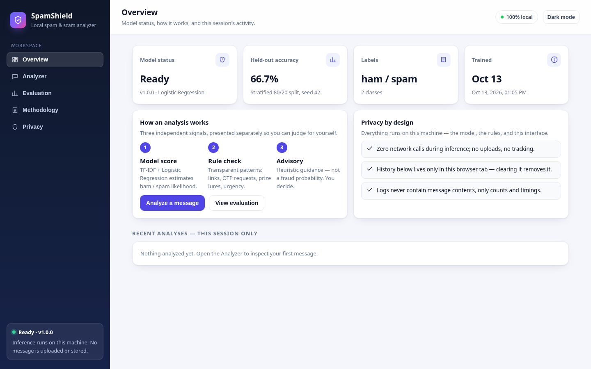
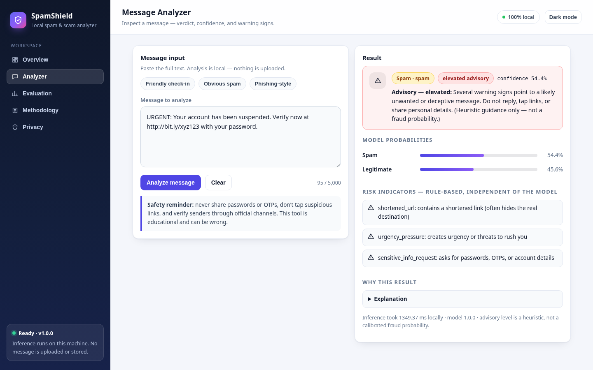
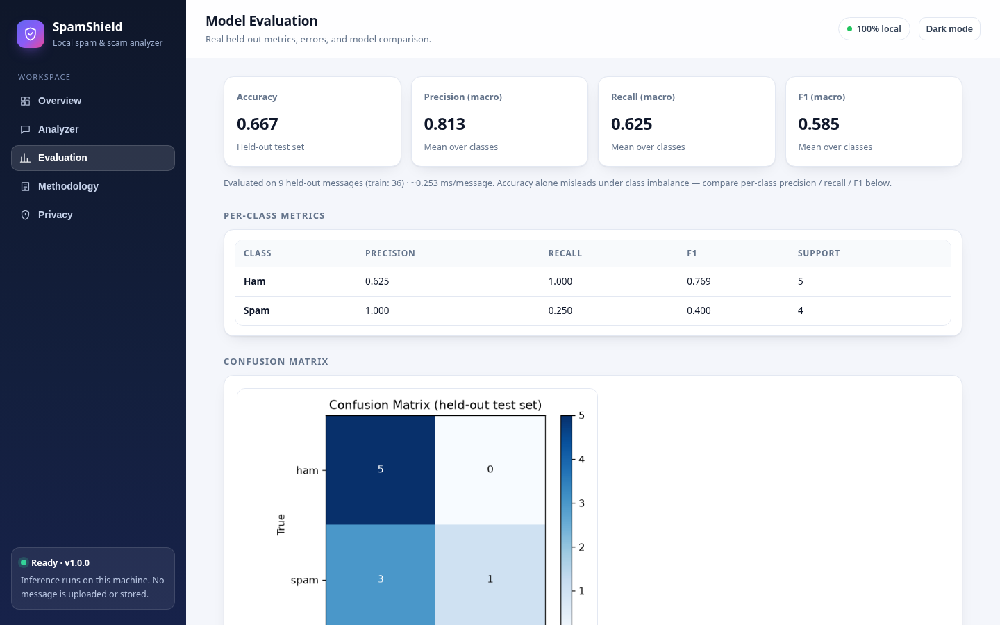
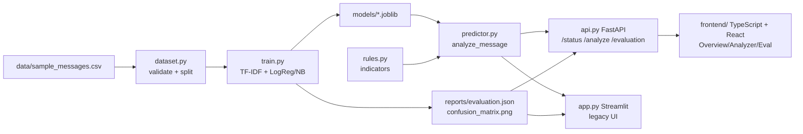

# 🛡️ SpamShield — AI Spam and Scam Detector

> **Detect suspicious messages. Understand the warning signs.**

SpamShield is a lightweight, **100% local** machine-learning app that analyzes
text messages and estimates whether they are legitimate, spam, or potentially
scammy — then explains *why*. No paid APIs, no GPU, no cloud, no tracking.
An educational ML project, not a production security product.

## Screenshots (TypeScript UI)





Legacy Streamlit shots (`dashboard.png`, `analyzer-result.png`, `evaluation.png`)
remain in `docs/screenshots/` for reference.

## Features

- TF-IDF + Logistic Regression classifier (Naive Bayes baseline for comparison)
- `analyze_message(text)` prediction engine: prediction, probabilities,
  rule-based risk indicators, plain-language explanation, heuristic advisory level
- Transparent rule warnings (suspicious URLs, OTP/password requests, prize lures,
  urgency, impersonation…) — independent of the model, never replacing it
- Professional TypeScript + React UI (Overview, Analyzer with verdict banner
  and probability bars, Evaluation tables, Methodology, Privacy) served by a
  local FastAPI backend; Streamlit `app.py` kept as a legacy alternative
- Reproducible training with stratified split, timing + memory reporting
- Confusion matrix, per-class metrics, error analysis, model comparison report
- pytest suite covering validation, rules, privacy (no message logging)

## Architecture



## Technology stack

Python 3.11+ · scikit-learn · pandas · NumPy · joblib · FastAPI + **TypeScript + React + Vite**
(Streamlit `app.py` kept as legacy) · Matplotlib · pytest.
No TensorFlow/PyTorch/LLMs, no databases, no external services.

## Hardware requirements

Any CPU-only machine (e.g. Intel Core i3, Windows 11). Total cost ₱0.
Low-memory tips: close other apps, use `--max-features 2000`, prefer the
bundled 45-row sample or the ~5.5k SMS Spam Collection (no huge downloads).

## Installation

**Windows (PowerShell):**
```powershell
py -m venv .venv
.venv\Scripts\activate
python -m pip install --upgrade pip
pip install -r requirements.txt
```

**Linux/macOS:**
```bash
python3 -m venv .venv
source .venv/bin/activate
python -m pip install --upgrade pip
pip install -r requirements.txt
```

No API keys or environment variables needed. No admin rights needed.

## Dataset setup

The bundled synthetic sample works out of the box. For a real dataset, manually
download the SMS Spam Collection (UCI ML Repository) and convert it — see
`data/README.md`. Respect its license and cite it. Never auto-downloaded.

## Model training

```powershell
python train.py --data data/sample_messages.csv
python train.py --data data/sample_messages.csv --compare   # + Naive Bayes comparison
```

Saves `models/spamshield_model.joblib`, `models/model_metadata.json`,
`reports/evaluation.json`, `reports/confusion_matrix.png` (git-ignored,
regenerated locally). Inference afterwards needs **no internet**.

## Running the app (recommended: TypeScript UI + FastAPI)

Requires Python 3.11+ and Node.js 18+ (Vite 5; verified on Node 20).

```bash
pip install -r requirements.txt
python train.py --data data/sample_messages.csv   # once, generates local model + reports
cd frontend && npm install && npm run build && cd ..
python api.py                                     # -> http://127.0.0.1:8000
```

Dev mode with hot reload:

```bash
python api.py                                     # terminal 1 (API on :8000)
cd frontend && npm install && npm run dev         # terminal 2 (UI on :5173, proxies /api)
```

API endpoints: `GET /api/health`, `GET /api/status`, `POST /api/analyze {"text": "..."}`,
`GET /api/evaluation`, `GET /api/confusion-matrix`. The built UI is served from `/` by `api.py`.

## Running the legacy Streamlit UI

```powershell
streamlit run app.py
```

## Testing

```powershell
python -m pytest -q
```

## Evaluation methodology

Stratified train/test split (seed 42, 80/20); metrics computed on the held-out
test set only: accuracy, macro/weighted precision, recall, F1, per-class
report, confusion matrix, FP/FN examples, inference latency. Accuracy alone is
insufficient under class imbalance — always read per-class recall/F1.

**Actual results (bundled 45-message synthetic sample, 36 train / 9 test):**

| model | accuracy | precision (macro) | recall (macro) | F1 (macro) |
|---|---|---|---|---|
| Logistic Regression (default) | 0.667 | 0.813 | 0.625 | 0.585 |
| Naive Bayes (baseline, `--compare`) | 0.889 | 0.917 | 0.875 | 0.883 |

LogReg's spam recall is only 0.25 on this tiny test set (3 missed spam) — a
textbook case of why accuracy alone misleads and why per-class metrics matter.
NB generalizes better here. *(Regenerated by `train.py`; illustrative only —
tiny synthetic data. See `reports/evaluation.json` and
`reports/model_comparison.json` after you train.)*

## Example predictions

| message | model | advisory |
|---|---|---|
| "Hey, are we still meeting for lunch tomorrow?" | ham | low |
| "WINNER! claim your $1000 prize now!" | spam | caution |
| "URGENT: account suspended, verify at http://bit.ly/x with password" | spam + indicators | elevated |

*(Verified against the live API: the prize lure triggers one rule hit, so the
heuristic lands on `caution` — `elevated` needs spam plus 2+ indicators.)*

## Privacy and security

- All inference local; zero network calls; no uploads; session-only history.
- Logs never contain message contents; 5000-char input cap.
- ⚠️ `joblib` files are pickle-based — only load models you trained or trust.

## Known limitations

- Synthetic sample → narrow vocabulary; English short-text only.
- No verified scam labels bundled → no validated scam-detection claims.
- Model scores are not calibrated fraud probabilities; rules are heuristics.
- Can be wrong — always verify senders via official channels.

## Future improvements

- Manual SMS Spam Collection training + Taglish support
- Probability calibration, threshold tuning UI
- Character n-grams for obfuscated spam, batch CSV analysis
- Exportable PDF report of an analysis

## License

MIT — see `LICENSE`.

## Author

Your Name — portfolio project (educational, 2026).
